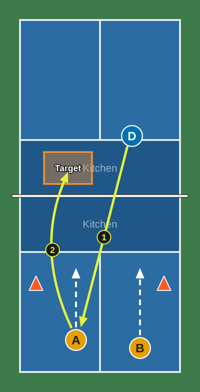

# drillplot

[](https://www.npmjs.com/package/drillplot)
[](https://www.npmjs.com/package/drillplot)
[](https://github.com/maikuru/drillplot/actions/workflows/ci.yml)
[](https://github.com/maikuru/drillplot/actions/workflows/codeql.yml)
[](LICENSE)
[](docs/api.md)
[](https://www.npmjs.com/package/drillplot?activeTab=code)
[](https://maikuru.github.io/drillplot/)

Draw pickleball drill diagrams on a to-scale court and export editable SVG.

<p align="center">
  
</p>

drillplot is a small TypeScript library and a drop-in web component. You place players, cones, a ball machine and target zones on a 20 by 44 foot court, draw numbered drives, drops and movement arrows, and export an SVG that carries its own editable source, so a diagram can be reopened and changed later. No framework, no runtime dependencies. [Try the live demo](https://maikuru.github.io/drillplot/).

The image above is [`docs/sample-drill.svg`](docs/sample-drill.svg), produced by `renderSvg(sampleDrill())`. Paste its text into the editor's Open from source box and it is editable.

## Contents

- [Quick start](#quick-start): [install](#install), [render an SVG](#render-an-svg), [the editor in plain HTML](#the-editor-in-plain-html), [React](#react), [Vue](#vue)
- [The editor reference](#the-editor-reference): [attributes and properties](#attributes-and-properties), [methods](#methods), [events](#events), [keyboard](#keyboard), [theming](#theming), [parts](#parts)
- [Validating a source](#validating-a-source): [with parseSource](#with-parsesource), [with the JSON Schema](#with-the-json-schema)
- [Browser and Node support](#browser-and-node-support)
- [Accessibility](#accessibility)
- [Documentation](#documentation)
- [Contributing](#contributing) and [Releasing](#releasing)
- [License](#license)

## Quick start

### Install

```sh
npm install drillplot
```

drillplot ships ES modules and TypeScript declarations, and has no runtime dependencies. It is ESM only (there is no `require` entry). There are three entry points:

| Import | What it gives you | Needs a DOM |
| --- | --- | --- |
| `drillplot` | The format types and limits, the validator, the SVG renderer, `sampleDrill()` | No |
| `drillplot/editor` | Registers `<drillplot-editor>` and exports `DrillplotEditor`, `defineDrillplotEditor`, `DrillModel`, `TOKENS` | Yes, a browser |
| `drillplot/schema` | The JSON Schema (draft 2020-12) for the source format | No |

### Render an SVG

Works in Node 20 or newer, a bundler, or a browser, without a DOM.

```js
import { writeFileSync } from 'node:fs';
import { parseSource, renderSvg, sampleDrill } from 'drillplot';

const result = parseSource(JSON.stringify(sampleDrill())); // validates and normalizes; takes an object or JSON text
if (result.ok) {
  writeFileSync('drill.svg', renderSvg(result.source)); // a string of standalone SVG
  const grey = renderSvg(result.source, { greyscale: true }); // display only
} else {
  for (const e of result.errors) console.error(e.key, e.path, e.message);
}
```

`renderSvg` expects a validated source: pass it `parseSource(...).source`. It is not defensive about other input. For a validated source it is deterministic (the same source gives the same text), uses explicit fills and strokes (no CSS, no `currentColor`), sets a `viewBox`, a `<title>`, a `<desc>` when there is a caption, and puts the source JSON, XML-escaped, in `<metadata>`. It adds no `id` or `class`, so any number of exports can share a page. All text from a source (title, caption, labels) is escaped.

The greyscale option turns every color into its grey, to show what a black and white printer makes of a drawing. It is for display. The editor's Get SVG never uses it, and nothing stores it.

To reopen an exported SVG, or pasted JSON, no DOM needed:

```js
import { parseText } from 'drillplot';

const r = parseText(svgOrJsonText); // reads <metadata> from an SVG, or parses JSON
```

### The editor in plain HTML

```html
<drillplot-editor id="ed" save-label="Save drill"></drillplot-editor>
<script type="module">
  import 'drillplot/editor'; // registers <drillplot-editor>
  import { sampleDrill } from 'drillplot';

  const ed = document.getElementById('ed');
  ed.source = sampleDrill(); // an object, JSON text or an exported SVG. Does not fire "change".
  ed.addEventListener('change', (e) => console.log(e.detail.source)); // after every edit
  ed.addEventListener('save', (e) => upload(e.detail.svg, e.detail.source)); // Save button or Ctrl/Cmd + S
</script>
```

Without a bundler, serve the package's `dist` folder and import `dist/index.js` and `dist/editor.js` by URL, as [`demo/index.html`](demo/index.html) does.

### React

The editor is a custom element, so a React wrapper sets properties and listens for DOM events itself. Import `drillplot/editor` dynamically: the module needs a browser and fails if a server evaluates it (see [Browser and Node support](#browser-and-node-support)).

```tsx
import { useEffect, useRef } from 'react';
import type { DrillSource } from 'drillplot';
import type { DrillplotEditor, ChangeDetail, SaveDetail } from 'drillplot/editor';

declare module 'react' {
  namespace JSX {
    interface IntrinsicElements {
      'drillplot-editor': React.DetailedHTMLProps<React.HTMLAttributes<DrillplotEditor>, DrillplotEditor> & {
        theme?: 'light' | 'dark';
        'save-label'?: string;
      };
    }
  }
}

interface Props {
  initial?: DrillSource;
  onChange?: (source: DrillSource) => void;
  onSave?: (source: DrillSource, svg: string) => void;
}

export function DrillEditor({ initial, onChange, onSave }: Props) {
  const ref = useRef<DrillplotEditor>(null);
  const handlers = useRef({ onChange, onSave });
  handlers.current = { onChange, onSave };

  useEffect(() => {
    let cancelled = false;
    let cleanup = () => {};
    void import('drillplot/editor').then(() => {
      const el = ref.current;
      if (cancelled || !el) return;
      if (initial) el.source = initial;
      const change = (e: Event) => handlers.current.onChange?.((e as CustomEvent<ChangeDetail>).detail.source);
      const save = (e: Event) => {
        const { source, svg } = (e as CustomEvent<SaveDetail>).detail;
        handlers.current.onSave?.(source, svg);
      };
      el.addEventListener('change', change);
      el.addEventListener('save', save);
      cleanup = () => {
        el.removeEventListener('change', change);
        el.removeEventListener('save', save);
      };
    });
    return () => {
      cancelled = true;
      cleanup();
    };
  }, []); // load `initial` once; see the note below

  return <drillplot-editor ref={ref} save-label="Save drill" />;
}
```

Treat the editor as the owner of the drawing while it is on screen. Assigning `source` replaces the drawing and clears the selection, so do not write every `change` back into `source`. Set `source` when the diagram being edited changes (for example, give the component a `key` per diagram, or assign it in an effect that depends on the diagram's id).

### Vue

Tell Vue that `drillplot-editor` is a custom element (in Vite: `vue({ template: { compilerOptions: { isCustomElement: (tag) => tag === 'drillplot-editor' } } })`), then use `.prop` to set the property and `@change` and `@save` for the events:

```vue
<script setup lang="ts">
import 'drillplot/editor'; // in Nuxt or other server rendering, import it in onMounted instead
import { sampleDrill } from 'drillplot';
import type { ChangeDetail, SaveDetail } from 'drillplot/editor';

const initial = sampleDrill();
const onChange = (e: CustomEvent<ChangeDetail>) => console.log(e.detail.source);
const onSave = (e: CustomEvent<SaveDetail>) => console.log(e.detail.svg);
</script>

<template>
  <drillplot-editor :source.prop="initial" @change="onChange" @save="onSave" />
</template>
```

The same caution as in React applies: bind the initial drawing, not a value you update on every `change`.

## The editor reference

`<drillplot-editor>` is a self-contained widget with a palette (players A to D and a coach, ball machine, cone, target zone), select, move and nudge, delete, undo and redo, an inspector, Full court, Half court and Kitchen zoom views, Portrait and Landscape, the greyscale view, Get SVG (with Copy SVG and Copy source) and Open from source. Every method and type is in [docs/api.md](docs/api.md).

### Attributes and properties

| Name | Kind | What it does |
| --- | --- | --- |
| `source` | attribute | JSON text (or an exported SVG) to load. A source that fails validation fires `source-error` and leaves the drawing as it was. |
| `source` | property | Get the current source as a `DrillSource` (a fresh copy without editor ids). Set it to an object, JSON text or an exported SVG to load it. Setting `null` does nothing. Loading does not fire `change`, and it clears the undo history. |
| `greyscale` | attribute and property (boolean) | The display-only greyscale view. Exports are never greyscale. |
| `theme` | attribute | `light` or `dark`. Without it the editor follows `prefers-color-scheme`. |
| `save-label` | attribute | Text of the Save button. Default `Save`. |

### Methods

| Method | What it does |
| --- | --- |
| `load(input)` | Same as setting `source`, but returns the `ParseResult` so you can read the errors. |
| `getSource()` | The current `DrillSource`. |
| `getSvg()` | The exported SVG text, always in color. The same text as Get SVG and the `svg` of a `save` event. |

`defineDrillplotEditor(name)` registers the editor under another tag name as well. Importing `drillplot/editor` has already registered `<drillplot-editor>`.

### Events

| Event | When | `detail` |
| --- | --- | --- |
| `change` | After every edit the user makes (not after loading a source from outside). Bubbles and is composed. | `{ source }` |
| `save` | The Save button, or Ctrl or Cmd + S. Bubbles and is composed. | `{ source, svg }` |
| `source-error` | A source set from outside was refused. It does not bubble. | `{ errors }`, an array of `{ key, path, message }` |

### Keyboard

| Keys | Where | Action |
| --- | --- | --- |
| Enter | Court, with a palette piece chosen | Place the piece at a free spot |
| Enter | Court, with an arrow tool chosen | Add an arrow, then adjust it with the coordinate fields |
| Arrow keys | Court, with a piece selected | Nudge it half a foot (in Landscape the arrows follow the screen, not the court axes) |
| Delete or Backspace | Court, with a piece selected | Remove it (not while typing in a field, or with a button focused) |
| Ctrl or Cmd + Z | Anywhere except a text field | Undo |
| Ctrl or Cmd + Shift + Z, or Ctrl or Cmd + Y | Anywhere except a text field | Redo |
| Ctrl or Cmd + S | Anywhere in the editor | Fire `save` |
| Escape | Anywhere in the editor | Close an open sheet, or the clear confirmation, or leave the tool and selection |

Dragging snaps to a quarter foot. Undo covers the pieces on the court and Open from source; title, caption and view changes are not steps of their own.

### Theming

Custom properties inherit into the shadow tree, so set any of these on `drillplot-editor` or an ancestor. The exported `TOKENS` array lists the names (without the `--drillplot-` prefix) and a test keeps this list and the code in step.

| Property | What it sets |
| --- | --- |
| `--drillplot-font` | Font family |
| `--drillplot-surface`, `--drillplot-surface-sunken`, `--drillplot-surface-raised` | Panel and control backgrounds |
| `--drillplot-border`, `--drillplot-border-strong` | Borders |
| `--drillplot-text`, `--drillplot-text-muted` | Text |
| `--drillplot-accent`, `--drillplot-accent-text`, `--drillplot-accent-quiet` | The primary button and selected states |
| `--drillplot-danger`, `--drillplot-danger-quiet` | Destructive actions and errors |
| `--drillplot-focus` | Focus ring |
| `--drillplot-stage-bg` | Behind the court |
| `--drillplot-select` | Selection ring and handles |
| `--drillplot-radius` | Corner radius (default `6px`) |
| `--drillplot-touch-target` | Minimum control size (default `44px`) |
| `--drillplot-stage-height` | Height of the court area (default `min(78vh, 760px)`) |
| `--drillplot-side-width` | Width of the side panel (default `340px`) |

```css
drillplot-editor { --drillplot-accent: #7a1f5c; --drillplot-stage-height: 70vh; }
```

### Parts

The shadow DOM stops a host page's CSS from breaking the editor by accident, and stops the editor's ids and class names from clashing with the host. To restyle on purpose, use the tokens above or these `::part()` names:

| Part | Region |
| --- | --- |
| `root` | The whole editor |
| `toolbar` | The top bar: view, orientation, greyscale, undo, redo, delete, clear |
| `stage` | The court drawing (an `<svg>`) |
| `panel` | The side panel: title, caption, palette, inspector |
| `footer` | The bottom bar: Get SVG, Open from source, Save |
| `save` | The Save button |

```css
drillplot-editor::part(save) { text-transform: uppercase; }
```

## Validating a source

A source is JSON; the [format specification](docs/format.md) lists every field.

### With parseSource

```js
import { parseSource, validateSource } from 'drillplot';

const r = parseSource({ format: 'drill-diagram', version: 1, items: [{ type: 'cone', x: 30, y: 1 }] });
// { ok: false, errors: [{ key: 'out_of_bounds', path: '/items/0/x', message: '...' }] }

validateSource({ format: 'drill-diagram', version: 1, items: [] }); // just the errors: [] when it is valid
```

`parseSource` accepts a parsed value or JSON text, reports every problem it finds, and on success returns a normalized source (defaults filled in, numbers rounded to two decimals, unknown properties dropped, older team keys mapped). The `key` is stable and meant for code to branch on; the `message` is for people and may be reworded. All keys are explained in [docs/format.md](docs/format.md#error-keys).

### With the JSON Schema

[`schema/drill-diagram.v1.schema.json`](schema/drill-diagram.v1.schema.json) is JSON Schema draft 2020-12 and is tested against the validator on a shared set of good and bad samples. Its `$id` is `https://maikuru.github.io/drillplot/schema/drill-diagram.v1.schema.json`, where the demo site publishes it, and the package exports it as `drillplot/schema`.

```js
import Ajv2020 from 'ajv/dist/2020.js';
import schema from 'drillplot/schema' with { type: 'json' };

const ajv = new Ajv2020({ strict: true });
const validate = ajv.compile(schema);

validate({ format: 'drill-diagram', version: 1, items: [] }); // true
validate({ format: 'drill-diagram', version: 1 }); // false, validate.errors says "must have required property 'items'"
```

A schema describes the shape; `parseSource` is what the editor and renderer use, and it also normalizes. The two are tested to agree on what is valid. Use the schema where you cannot run JavaScript from this package (other languages, CI checks, editors with schema support).

## Browser and Node support

- **Renderer, validator, `parseText`**: plain ES2022 with no DOM and no dependencies. Node 20 or newer (the package's `engines`), any current bundler, any current browser.
- **Editor**: current evergreen browsers (Chrome, Edge, Firefox, Safari). It needs custom elements, shadow DOM, pointer events and `part`. Importing `drillplot/editor` in Node, or anywhere `HTMLElement` is not defined, throws. In a server-rendered app, import it only on the client (a dynamic `import()` in an effect). `defineDrillplotEditor` itself returns quietly when there is no `customElements`.
- **Types**: the declarations use `exports`, so TypeScript needs `moduleResolution` of `bundler`, `node16` or `nodenext`.
- **Building and testing this repository** needs Node 22 or newer; see [CONTRIBUTING.md](CONTRIBUTING.md).

## Accessibility

- Every control is a real button, radio, checkbox, select or input with a visible label, at least a 44 pixel touch target (36 for the small buttons), and a visible focus ring.
- The court can be worked without a pointer: the palette buttons place a piece when you press Enter, the piece list selects any piece, arrow keys nudge the selected piece, Delete removes it, and exact coordinate fields set a position. With an arrow tool chosen, Enter on the court adds an arrow you then adjust with the fields. Ctrl or Cmd + Z, Shift + Z and Y undo and redo; Ctrl or Cmd + S saves; Escape backs out of a tool, a selection or a sheet.
- Drag, tap-to-place and touch all work (pointer events, `touch-action: none` on the court).
- Status and hints are in live regions. Clearing the court asks first.
- The four player colors are from the Okabe-Ito set and differ in lightness as well as hue, so they stay apart for color-blind viewers and on a black and white printer. Use the Greyscale view to check a diagram. Player letters are always drawn on the piece, so color is never the only signal.
- Exported SVGs are `role="img"`, with an `aria-label` and a `<title>`, and a `<desc>` from the caption. A good caption is the accessible description: say what the drill does, not only what is drawn.
- `prefers-reduced-motion` is respected (there is no motion to speak of).

## Documentation

- [docs/format.md](docs/format.md): the `drill-diagram` version 1 format as a specification: every field, limits, court geometry, coordinates, versioning, error keys.
- [docs/api.md](docs/api.md): every export of `drillplot`, `drillplot/editor` and `drillplot/schema`, with signatures and examples.
- [CHANGELOG.md](CHANGELOG.md): what changed in each release.
- [CONTRIBUTING.md](CONTRIBUTING.md), [CODE_OF_CONDUCT.md](CODE_OF_CONDUCT.md), [SECURITY.md](SECURITY.md).

## Contributing

Bug reports, ideas and pull requests are welcome. Setup, the scripts, how to change the format safely, and the pull request flow are in [CONTRIBUTING.md](CONTRIBUTING.md). Please read the [Code of Conduct](CODE_OF_CONDUCT.md), and report security problems privately as described in [SECURITY.md](SECURITY.md).

## Releasing

Releases publish from GitHub Actions with npm trusted publishing (OIDC), so no npm token is stored anywhere, and npm records the release's provenance. Maintainers bump the version with `npm version` and push the tag; the steps and the checks the workflow runs are in [CONTRIBUTING.md](CONTRIBUTING.md#releasing).

## License

[MIT](LICENSE).
